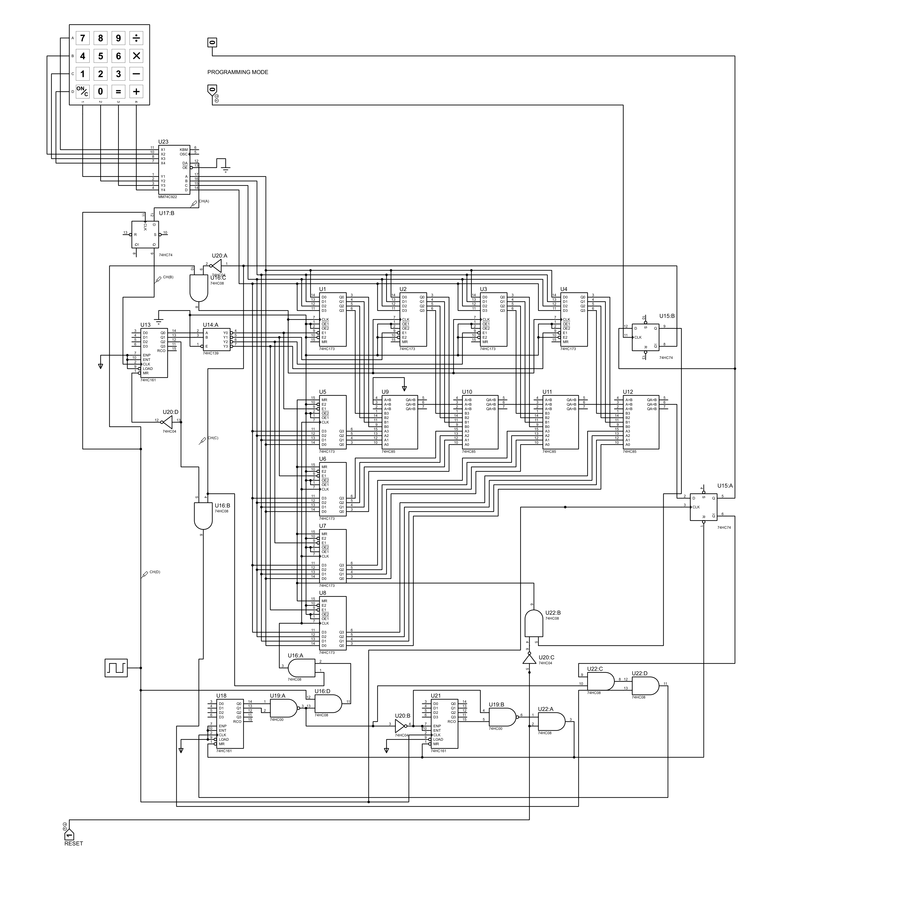

# Digital Password Vault & Access Control System 🔐

A digital password-based access control system designed and simulated using **Proteus** as part of the Digital Logic Design (DLD) course at **GIKI**.

The project demonstrates how combinational and sequential logic circuits can be integrated to implement a password authentication system using discrete logic ICs, without relying on a conventional microcontroller-based architecture.

## 🚀 Features

- **Keypad-Based Input:** Accepts password input through a 4×4 matrix keypad.
- **Password Storage:** Uses digital registers to store entered and predefined passwords.
- **Password Verification:** Compares entered credentials with the stored password using digital comparator logic.
- **Failed Attempt Detection:** Tracks unsuccessful authentication attempts using binary counters.
- **Access Control:** Controls the locked and unlocked states through sequential logic.
- **Automatic Relocking:** Uses a timer circuit to automatically restore the locked state after a defined interval.

## ⚙️ Hardware Components & ICs

The design uses various digital logic ICs to implement its functionality.

| Component | Function |
|---|---|
| 74C922 | Keypad encoder |
| 74HC173 | 4-bit data registers |
| 74HC161 | Binary counters |
| 74HC139 | 2-to-4 decoder |
| 74HC85 | Magnitude comparator |
| 74HC74 | D flip-flops |
| 74HC08 | AND gates |
| 74HC04 | NOT gates |
| 74HC00 | NAND gates |
| NE555 | Timer circuit |

*Note: The component list may be updated as the final circuit design evolves.*

## 🧠 Digital Logic Concepts

This project applies several fundamental concepts of digital electronics:

- Combinational Logic
- Sequential Logic
- Binary Counters
- Registers and Data Storage
- Flip-Flops
- Decoders and Encoders
- Magnitude Comparison
- Clock and Timing Circuits
- State-Based Access Control

## 🖥️ Simulation

The complete circuit is designed and simulated using **Proteus Design Suite**.

### Circuit Schematic

Add your complete circuit screenshot here.

```markdown

```

### Simulation Demonstration

Add screenshots or a demonstration video showing:

- Password entry
- Successful authentication
- Incorrect password detection
- Failed attempt counting
- Automatic relocking

## 📁 Repository Structure

```text
Digital-Password-Vault/
│
├── Proteus/
│   └── DigitalVault.pdsprj
│
├── Images/
│   ├── circuit.png
│   ├── successful-access.png
│   └── failed-access.png
│
├── Videos/
│   └── demonstration.mp4
│
└── README.md
```

## 🛠️ Tools Used

- **Proteus Design Suite** – Circuit design and simulation.
- **Digital Logic ICs** – Hardware-level implementation.
- **Git & GitHub** – Version control and project documentation.

## 🎯 Project Objectives

The primary objective is to develop a functional password-based access control system while gaining practical experience with digital logic design.

The project emphasizes understanding how individual logic components can be interconnected to create a complete sequential system, including data storage, authentication, error detection, and timed access control.

## 👨‍💻 Contributors

Developed as an academic project for the Digital Logic Design course at **Ghulam Ishaq Khan Institute (GIKI)**.

---

**Digital Logic Design | Proteus | Digital Electronics | GIKI**
